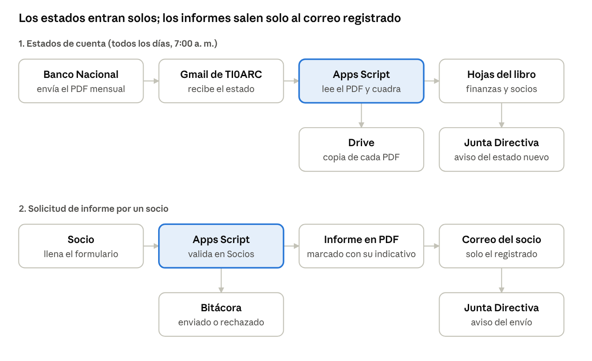

# Sistema automatizado de finanzas y socios – TI0ARC

Sistema en Google Apps Script que mantiene al día, de forma automática, las finanzas y el registro de socios de la **Asociación de Radioaficionados de Cartago (TI0ARC)**, Costa Rica. Funciona dentro de una cuenta de Google y no tiene costo.

Importa los estados de cuenta del Banco Nacional de Costa Rica que llegan por correo, arma el resumen mensual y el detalle de movimientos, lleva la lista de socios con su estado de membresía y permite que cualquier socio activo pida el informe financiero de un período, que recibe en PDF solo en su correo registrado.

Autor: Ing. William Marín Moreno, Fiscal de TI0ARC.

## Contenido del repositorio

| Archivo | Descripción |
| --- | --- |
| `Codigo.gs` | Código completo del Apps Script |
| `appsscript.json` | Manifiesto del proyecto: zona horaria y servicio avanzado Drive API |
| `docs/flujo.png` | Diagrama del funcionamiento |

## Cómo funciona

El sistema tiene dos flujos:

1. **Estados de cuenta:** todos los días a las 7:00 a. m. el script revisa Gmail, lee los PDF nuevos del banco, guarda una copia en Drive, actualiza las hojas y avisa a la Junta.
2. **Solicitud de informe:** un socio llena un formulario con su indicativo y los meses; el script valida en la hoja Socios, genera el PDF con marca de agua y lo envía solo a su correo registrado.

## Capacidades

### Importación automática de estados de cuenta

- Reconoce los estados de la cuenta configurada en dos formatos: el actual (tabla por filas) y el antiguo de 2018–2022 (tabla por columnas).
- Ignora los estados de otras cuentas (por ejemplo, la cuenta en dólares) y los adjuntos de glosario.
- Guarda cada PDF en una carpeta de Drive con un nombre por fecha y no duplica un estado aunque llegue dos veces.
- Verifica que cada saldo diario cuadre con el anterior; si no cuadra, marca el estado como "REVISAR".
- Detecta los meses sin estado de cuenta por diferencia de saldos y los muestra en amarillo con el neto de ese lapso.

### Hojas del libro

| Hoja | Contenido |
| --- | --- |
| **Resumen de finanzas** | Una fila por mes: saldo inicial, ingresos, egresos, movimientos, saldo calculado, saldo según el banco y diferencia (debe ser cero) |
| **Movimientos** | Todas las transacciones por mes, ordenadas por fecha real de la transacción, con saldo recalculado, columna **Nota** editable y un resumen de cada mes |
| **Informe** | Informe de cualquier período, eligiendo mes inicial y final en listas desplegables |
| **Socios** | Lista de socios, estado de membresía, pagos detectados y configuración del sistema |
| **Bitácora de solicitudes** | Registro de cada solicitud de informe y su resultado |

Las hojas ocultas **Estados**, **Datos** y **Notas** guardan la información original; las visibles se reconstruyen a partir de ellas. Las notas escritas en Movimientos o en Informe se sincronizan entre ambas y no se pierden al reconstruir.

### Socios y membresías

- Detecta los pagos de membresía en los movimientos del banco por el indicativo o por el nombre de quien paga, y descarta rifas, actividades, donaciones y aportes.
- Calcula el **período pagado** (por ejemplo 2026-2027) a partir del último pago. Se puede escribir a mano para pagos en efectivo, hechos por otra persona o intercambios.
- Tres estados:
  - **Activo:** su período pagado lo cubre.
  - **Por confirmar:** está en la lista validada en la asamblea, pero todavía no se ve su pago.
  - **Vencido:** no lo cubre ni el pago ni la lista.

### Solicitud de informes

- Un formulario de Google pide el indicativo y los meses inicial y final.
- El script verifica que sea socio activo, que tenga correo registrado y que no supere el límite diario de solicitudes.
- El informe se envía **solo al correo registrado** en la hoja Socios, nunca a un correo escrito en el formulario.
- El PDF incluye el estado de la membresía, su fecha de vencimiento y las notas de los movimientos.
- El mensaje de confirmación del formulario es el mismo para todos, de modo que no revela a un tercero quién es socio.

### Seguridad del PDF

- **Marca de agua** diagonal repetida en toda la página con el indicativo, el nombre y la fecha del solicitante: cualquier captura de pantalla la muestra.
- Encabezado y pie en cada página con la identificación del solicitante.
- Texto del color del fondo en las celdas vacías con el indicativo del solicitante, que deja rastro si el contenido se copia.

### Notificaciones

Hasta cuatro correos de la Junta reciben avisos cuando entra un estado de cuenta nuevo, cuando ocurre un error, cuando un socio sin correo registrado pide un informe y cuando se envía un informe con éxito.

## Instalación

1. Desde la cuenta de Google de la asociación, cree un libro de Google Sheets y abra **Extensiones → Apps Script**.
2. Reemplace el contenido de `Código.gs` con el de `Codigo.gs`.
3. En **Configuración del proyecto**, marque "Mostrar el archivo de manifiesto appsscript.json" y reemplace su contenido con el de `appsscript.json`. Esto agrega Drive API v3 y la zona horaria. (También puede agregar Drive API desde **Servicios +**.)
4. Ajuste en `CFG`, al inicio de `Codigo.gs`, la búsqueda de Gmail, el número de cuenta y el nombre de la carpeta de Drive.
5. Ejecute la función `actualizar` y acepte los permisos. La primera carga procesa todo el histórico del correo; si el registro indica que quedaron correos pendientes, ejecútela de nuevo.
6. Recargue la hoja. En el menú **TI0ARC**, use **Crear o actualizar formulario de solicitudes** y **Activar actualización diaria**.
7. Complete la configuración en la hoja **Socios** y registre a los socios.

> Si tiene varias cuentas de Google abiertas, el editor de Apps Script puede fallar con "No se pudo abrir el archivo". Use una ventana con solo la cuenta de la asociación.

### Permisos que solicita

| Permiso | Para qué |
| --- | --- |
| Gmail (lectura) | Buscar los estados de cuenta |
| Drive y Documentos | Guardar los PDF y convertirlos a texto; generar el informe |
| Hojas de cálculo | Actualizar el libro |
| Formularios | Crear el formulario y recibir las solicitudes |
| Envío de correo | Enviar informes y notificaciones |
| Servicio externo | Descargar la biblioteca [pdf-lib](https://pdf-lib.js.org) para la marca de agua |

## Configuración (hoja Socios)

| Campo | Ejemplo | Uso |
| --- | --- | --- |
| Cuota de membresía (₡) | 10000 | Detectar pagos de membresía |
| Lista de socios vigente hasta | 15/10/2027 | Fecha de la próxima asamblea; también da el día y mes de vencimiento de los períodos |
| Mes de corte (1-12) | 8 | Pagos desde este mes cuentan para el período siguiente |
| Máximo de solicitudes por día | 1 | Límite de informes por socio |
| WhatsApp | 8307-6432 | Contacto en el formulario, el correo y el PDF |
| Enlace del formulario | — | Se llena solo al crear el formulario |
| Correo de notificaciones 1 a 4 | — | Reciben los avisos de la Junta |

## Menú TI0ARC

| Opción | Qué hace |
| --- | --- |
| Actualizar ahora | Revisa el correo, importa los estados nuevos y actualiza todas las hojas |
| Reconstruir hojas | Vuelve a armar las hojas con los datos ya guardados, sin revisar el correo |
| Generar informe del período | Regenera la hoja Informe |
| Actualizar estado de socios | Recalcula pagos, períodos y estados |
| Crear o actualizar formulario de solicitudes | Crea el formulario la primera vez; después lo actualiza sin cambiar el enlace |
| Activar actualización diaria | Programa la revisión automática a las 7:00 a. m. |

La función `reprocesarTodo` (vuelve a leer todo el correo desde cero) no está en el menú para evitar ejecutarla por error; solo se ejecuta desde el editor. `probarSolicitud` simula una solicitud de informe y `diagnosticarFormatoAntiguo` muestra cómo se lee un PDF del formato antiguo.

## Mantenimiento anual

1. Después de cada asamblea, actualizar **Lista de socios vigente hasta** a la fecha de la siguiente.
2. Quitar de la hoja a quienes ya no son socios y agregar a los nuevos (indicativo y nombre completo).
3. Revisar los socios en **Por confirmar** y registrar a mano los pagos que el banco no muestra.

## Detalles técnicos

- **Lectura de PDF:** cada PDF se convierte a un documento de Google temporal para obtener su texto, que luego se borra. El formato antiguo trae la tabla por columnas; en ese caso el monto se calcula como la diferencia entre saldos diarios consecutivos.
- **Detección de membresías:** un ingreso cuenta como membresía si la descripción dice membresía, anualidad, afiliación, socio o renovación, o si el monto es múltiplo de la cuota y no menciona rifa, actividades ni aportes. Se asigna por indicativo o por coincidencia de al menos dos palabras del nombre de quien paga.
- **Límites de Google:** cada ejecución de Apps Script dura como máximo 6 minutos, por lo que la carga inicial guarda su avance y continúa en la siguiente ejecución. El PDF del informe se genera por lotes, con una tabla por mes, para respetar el límite de cambios de Google Docs.
- **Marca de agua:** se aplica con pdf-lib cargada desde cdnjs (con jsDelivr como respaldo). Si no se puede cargar, el informe se envía igual y la bitácora lo registra como "Enviado (sin marca de agua)".

## Limitaciones

- Google no permite proteger el PDF con contraseña; la marca de agua y la identificación en cada página cumplen esa función de forma disuasiva.
- Los pagos en efectivo, hechos por otra persona o por intercambio no aparecen en el banco y se registran a mano.
- La lectura de los PDF depende del formato del Banco Nacional; si el banco lo cambia, habrá que ajustar el lector.
